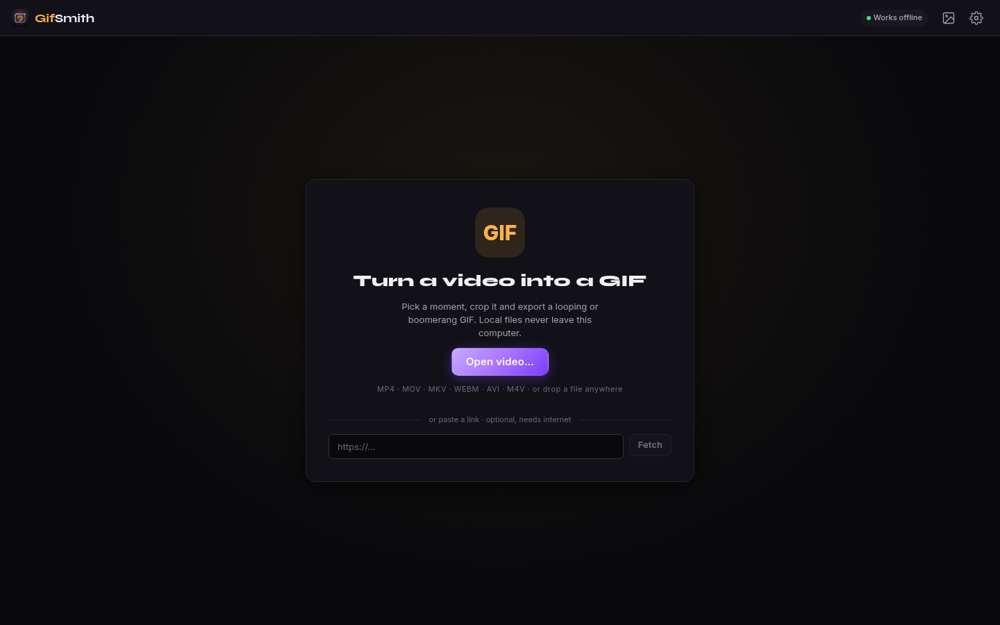
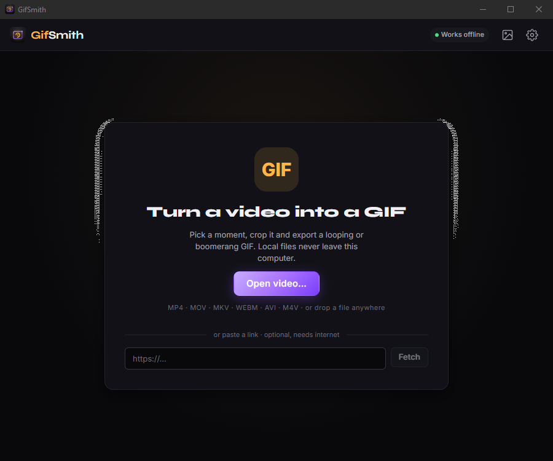
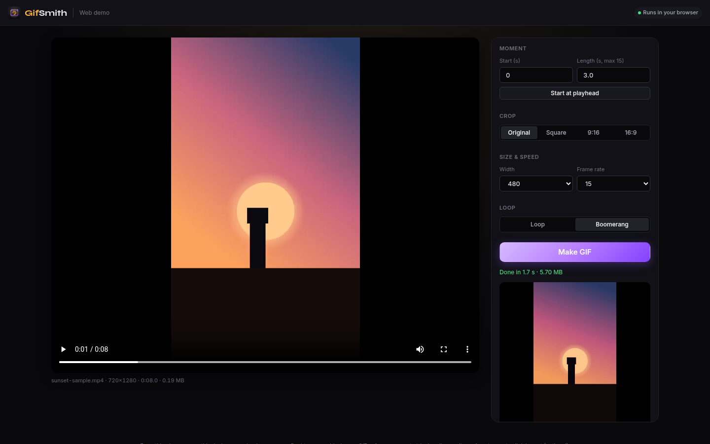

<p align="center">
  
</p>

<h1 align="center">GifSmith</h1>

<p align="center">Turn a slice of video into a high-quality GIF. Fully offline.</p>

<p align="center">
  <a href="https://github.com/ccharafeddine/GifSmith/releases"></a>
  <a href="https://github.com/ccharafeddine/GifSmith/actions/workflows/ci.yml"></a>
  <a href="https://github.com/ccharafeddine/GifSmith/releases"></a>
  <a href="LICENSE"></a>
  
  
</p>

---

GifSmith is a small, fast desktop app for Mac and Windows. Open a local video (or
import one from a link), scrub to pick start and end points, optionally crop and
adjust speed, and export a `.gif`. It's local-first: no accounts, no media
library, no telemetry, no ads. Local videos are read in place and never imported;
the only network feature is the optional URL import.

Built with [Tauri](https://v2.tauri.app), [SolidJS](https://www.solidjs.com), and
the [gifski](https://github.com/ImageOptim/gifski) encoder, with a bundled LGPL
build of [FFmpeg](https://ffmpeg.org) for decoding.

<p align="center">
  
</p>
<p align="center">
  
</p>

## Works offline

Every feature has a local path. You never need an internet connection or an account.

- Opening, cropping, encoding (gifski) and the gallery are all local.
- Link import is optional and is the only feature that uses the network.
- Fonts (Inter, Syne) and icons ship inside the app. Nothing loads from a CDN.

## Web demo

A browser version lives in the [MediaSmith repo](https://github.com/ccharafeddine/media-smith) (branch `design/v2-impl` until it is merged) under
`apps/smiths-web` (page `gif.html`). It runs on ffmpeg.wasm with local files only: no
server and no uploads. In the browser you can open or drop a local file, pick a start and a length (up to 15 s), crop, choose width and frame rate, then export a loop or boomerang palette GIF. Only the desktop app has
gifski quality, frame-accurate trim handles, shrink-to-fit size targets, gallery, link import. See MediaSmith `docs/web.md` for the build and hosting notes.

<p align="center">
  
</p>

## Features

- Open `mp4`, `mov`, `mkv`, `webm`, `avi`, `m4v` via file picker or drag-and-drop,
  **or import from a URL** (YouTube and other sites, via a bundled `yt-dlp`;
  direct links to a video file download straight over HTTP)
- A timeline with **filmstrip thumbnails** and iOS-style trim handles, **zoomable**
  down to a 30-second window for precise short clips
- **Crop** with a draggable, resizable rectangle (tracked in source pixels), with
  free-form or locked aspect ratios: 16:9, 9:16, and 1:1
- **Boomerang** (play forward then reversed), with live preview
- **FPS**, **width**, **quality**, and **speed** (0.5x-2x) controls, plus
  per-platform presets (Web, GIPHY, X, Discord) and a live frame/size estimate
- Preview the result before committing: **Save**, **Re-export**, or **Discard**.
  **Cancel** a long export mid-encode, or **clear** the loaded video without
  opening another
- Exports default to a **GifSmith/Exports** folder in your Documents (created on
  first save); you're free to save anywhere
- An **Exports gallery** (the header button) to browse past GIFs and reopen one
  as the source for a new edit
- **Plays codecs the system can't**: for formats the webview won't decode (HEVC,
  ProRes, ...) GifSmith builds a lightweight transcoded preview so trimming still
  works; export always uses the original file
- High-quality `gifski` encoding, streamed frame-by-frame with no intermediate
  files (a URL import downloads to a temp file that's deleted when you quit)
- Dark, minimal interface
- Native binaries for macOS (universal) and Windows

## Keyboard shortcuts

| Key | Action |
|---|---|
| `Space` | Play / pause |
| `←` / `→` | Step one source frame |
| `I` / `O` | Set the IN / OUT point at the playhead |
| `Esc` | Close the preview |
| Scroll over the timeline | Zoom in / out (cursor-anchored) |

## Install

Download the latest installer from the
[Releases](https://github.com/ccharafeddine/GifSmith/releases) page:

- **Windows**: the `.msi` (or setup `.exe`). Windows SmartScreen may warn on an
  unsigned app; choose **More info → Run anyway**.
- **macOS**: the universal `.dmg` (runs natively on both Apple Silicon and
  Intel). The app is unsigned, so the first launch needs the Gatekeeper
  workaround:

  > **Right-click** (or Control-click) the app in Applications → **Open** →
  > **Open** again in the dialog. You only need to do this once.

## Build from source

Prerequisites: [Node.js](https://nodejs.org) 20+ and the
[Rust toolchain](https://rustup.rs).

```bash
npm install

# Fetch the bundled binaries (FFmpeg/ffprobe + yt-dlp), placed in
# src-tauri/binaries with the per-target-triple names Tauri expects.
bash scripts/fetch-ffmpeg.sh        # Windows: BtbN LGPL static build
bash scripts/build-ffmpeg-macos.sh  # macOS: compile an LGPL build from source
bash scripts/fetch-ytdlp.sh         # yt-dlp, for URL import

# Run in development
npm run tauri dev

# Produce a production build for the current platform
npm run tauri build
```

## Bundled binaries & licensing

GifSmith is MIT licensed. The binaries it bundles, all invoked as separate
sidecar processes (never linked into the app), keep their own licenses:

- **FFmpeg** (LGPL). Windows uses the LGPL static build from
  [BtbN/FFmpeg-Builds](https://github.com/BtbN/FFmpeg-Builds); macOS is compiled
  from the official [FFmpeg](https://ffmpeg.org/download.html) source with
  `--disable-gpl --disable-nonfree` (no LGPL static macOS build is published).
  Source: <https://ffmpeg.org/download.html>.
- **yt-dlp** (Unlicense / public domain), for importing from a URL.
- **Font**: Syne (SIL Open Font License), bundled in `src/assets/fonts` with its
  license file. No web-font requests are made.

## Roadmap

Settings + update check shipped in v1.0.1. Next up:

1. **App-icon recolor** finished in the violet/cyan identity.
2. **Advanced quality control** (optional): gifski dithering / lossy level.
3. **Internal:** move `state.ts` to a Solid store as it grows.

Not scheduled: code-signing and notarization for both platforms (to drop the
Gatekeeper / SmartScreen prompts).

## License

[MIT](LICENSE) © Chafic Charafeddine. Bundled FFmpeg is LGPL and yt-dlp is
public domain, as noted above.

## Release notes

### v1.1.0

The v2 design release. GifSmith now matches the rest of the Smith suite. Grab the
installers from the [v1.1.0 release](https://github.com/ccharafeddine/GifSmith/releases/tag/v1.1.0).

- **New look:** the Smith v2 design system with the Inter font and a new logo
  and icons. The top bar has a "Works offline" chip and a compact Open button
  once a video is loaded.
- **Clearer start screen:** "Open video…" comes first, and link import is
  labelled optional, since local files never need the internet.
- **Shrink to fit:** export can re-encode until the GIF is under a size limit
  (for example Discord's 10 MB).
- **Link import from any site:** the yt-dlp import gains the ClipSmith
  scrape fallback for sites yt-dlp doesn't support.
- **More tests:** vitest frontend tests and broader Rust coverage, all run in CI.
- **Try it in a browser:** a web demo (crop, loop or boomerang GIF with ffmpeg.wasm)
  lives in the MediaSmith repo under `apps/smiths-web`.

### v1.0.1

- **Settings + update check.** A gearwheel in the header opens a settings popover
  with the app version and a **Check for updates** button that asks GitHub for the
  latest release (up-to-date / update-available states). An opt-in **Check on
  startup** toggle runs the check silently on launch and only surfaces when a
  newer version exists. It's prompt-only: an available update shows the release
  notes and a **Download** button that opens the release page. GifSmith never
  downloads or installs an update on its own.

### v1.0.0

The first stable release.

- **Universal macOS build**: a single `.dmg` runs natively on both Apple Silicon
  and Intel, replacing the earlier per-chip downloads.
- **URL import** from YouTube and other sites (bundled `yt-dlp`), or a direct
  link to a video file over HTTP, with a **Cancel** button for downloads in
  progress.
- **Timeline** with filmstrip thumbnails and zoomable iOS-style trim handles;
  **crop** (free-form or 16:9 / 9:16 / 1:1), **speed** (0.5x-2x), and
  **boomerang**, all with live preview.
- **Export presets** (Web, GIPHY, X, Discord) with a live frame-count and size
  estimate, then **Preview → Save / Re-export / Discard** before committing.
- **Exports gallery** to browse past GIFs and reopen one for a new edit.
- **Playback proxy** so videos in codecs the webview can't decode (HEVC,
  ProRes, ...) still preview; export always uses the original.
- Security: the URL import is restricted to `http(s)` links and hardened against
  argument injection into the downloader.
- Fixes: trim-handle edge cases on very short clips, and stale-preview races when
  switching sources quickly.

## Web demo

A standalone static build for https://gif.chafic.me/ is in [`web/dist/`](web/dist). See [`web/README.md`](web/README.md) for the required headers and how to rebuild it.
